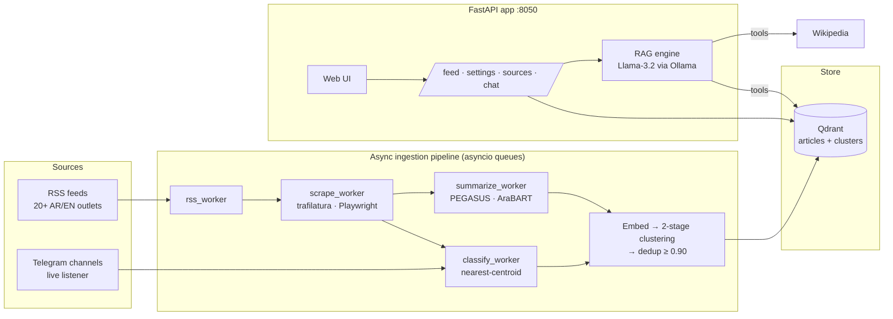

<div align="center">

# Briefley

**Arabic and English news intelligence: every story, from every outlet, summarised, grouped and searchable.**

Python · asyncio · FastAPI · PEGASUS · AraBART · Sentence-Transformers · Qdrant · Ollama (Llama-3.2) · Telethon · Playwright

</div>

---

## The problem

The same event is reported by dozens of outlets, in two languages, with different headlines and framing.
Reading all of it takes hours; reading one source hides the others.

Briefley collects the news from 20+ Arabic and English outlets and Telegram channels, summarises each
article in its own language, groups every outlet's version of the same story together, and lets you ask
questions answered only from what was actually reported, with sources.

## Features

| | |
| --- | --- |
| 📥 **Continuous ingestion** | An asynchronous pipeline pulls RSS feeds on a schedule, and a real-time Telegram listener picks up channel posts (with media) the moment they're published. |
| 📝 **Bilingual summaries** | Fine-tuned PEGASUS summarises English; fine-tuned AraBART summarises Arabic. |
| 🗂️ **Topic classification** | A nearest-centroid classifier over multilingual sentence embeddings sorts every article into a topic. |
| 🔗 **Story clustering** | Two-stage, category-aware agglomerative clustering (cosine, average linkage) groups each outlet's coverage of the same event, so you can compare headlines and framing side by side. |
| 🧹 **Deduplication** | Near-identical articles (≥ 0.90 embedding similarity) are collapsed after clustering. |
| 🤖 **Agentic RAG assistant** | A local Llama-3.2 with native tool calling chooses between vector search, story-cluster lookup and Wikipedia, and answers only from what its tools return. |
| ⚙️ **User-managed sources** | Turn feeds and Telegram channels on or off, or add new ones, from the web interface. No code changes. |

## Architecture



### Design choices

- **Queues, not a loop.** Each stage is an independent async worker connected by queues, so slow scraping
  never blocks summarisation, and a failing source never stops the run.
- **Cluster within a category first.** Clustering inside each topic before comparing across outlets keeps
  unrelated stories that share vocabulary from merging.
- **A local model for the assistant.** The RAG assistant runs on Ollama, so answering a question costs
  nothing per call and no article text leaves the machine.
- **The assistant must use its tools.** It's instructed to answer only from tool results and returns the
  sources it used.

## API

| Method | Endpoint | Purpose |
| --- | --- | --- |
| `GET` | `/api/feed` | Clustered, summarised stories |
| `GET` | `/api/settings` | Available and active sources |
| `GET` | `/api/status` | Ingestion status and last run |
| `POST` | `/api/rss/toggle` | Enable or disable a feed |
| `POST` | `/api/channels/toggle` | Enable or disable a Telegram channel |
| `POST` | `/api/resources/add` | Add a new source |
| `POST` | `/api/chat` | Ask the RAG assistant |
| `POST` | `/api/ingest/trigger` | Run ingestion now |

## Run it

**Prerequisites:** Python 3.10+, Docker (for Qdrant), [Ollama](https://ollama.com) with `llama3.2`, and the
model artifacts (fine-tuned summarisers, embedder, classifier centroids) in `./artifacts/`. The artifacts
are not committed because of their size.

```bash
docker compose up -d                 # Qdrant on :6333
ollama pull llama3.2
pip install -r requirements.txt
cp .env.example .env                 # Qdrant host/port, optional Telegram API credentials
python app.py                        # http://localhost:8050
```

Ingestion runs on startup and then every 6 hours; `POST /api/ingest/trigger` runs it on demand.

## Project history

Briefley started in 2024 as a B.Sc. graduation project. In 2026 it was rebuilt from the ground up as a
standalone application: the async pipeline, the Telegram listener, the clustering and deduplication, the
RAG assistant, the FastAPI backend and the web interface.

## License

Apache-2.0
